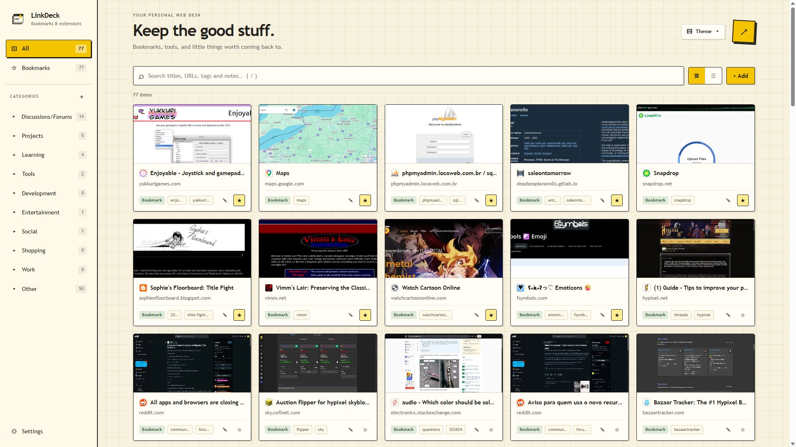
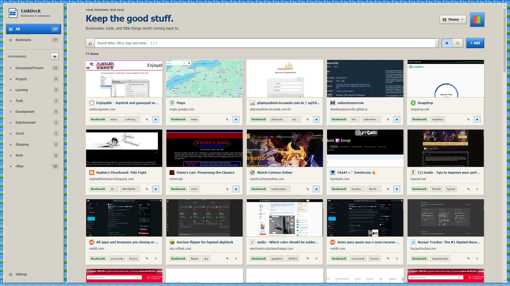
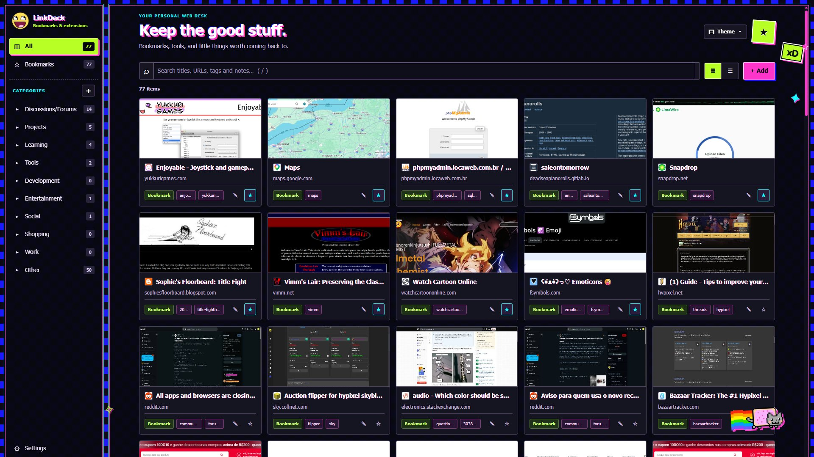
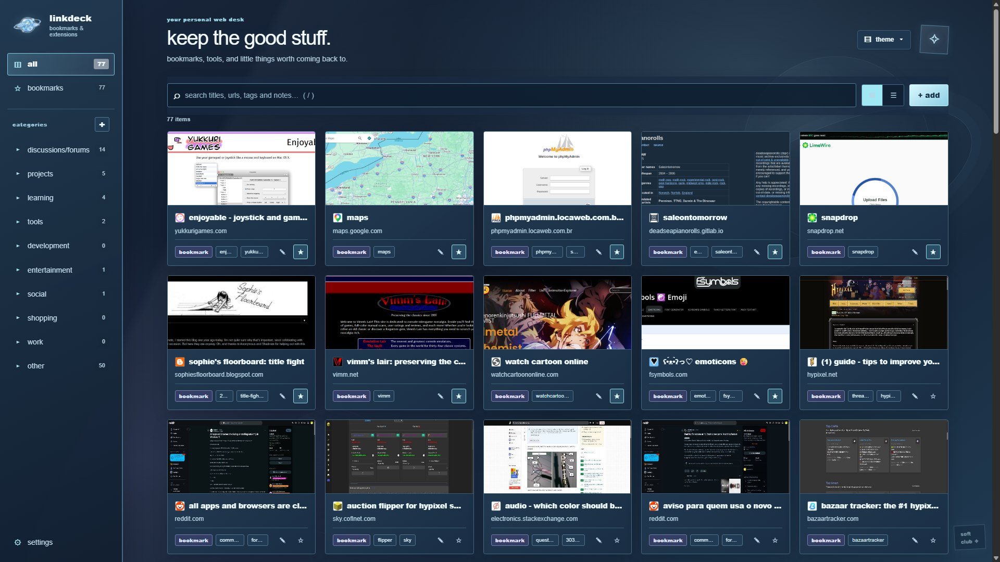
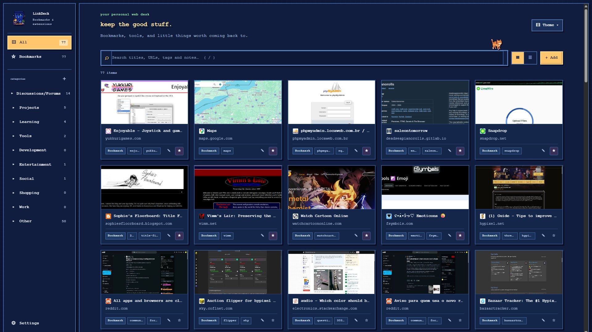

  <h1>LinkDeck</h1>
  
<strong>Your bookmarks, your style.</strong>

  
I got tired of having my bookmarks be a mess and never be able to find what I saved so I created LinkDeck.

---

## What is LinkDeck?

LinkDeck turns your browser bookmarks into a visual web desk. Instead of digging through a long list, browse your saved pages as cards, organize them with categories and tags, search your collection, and make the whole dashboard look amazing with the themes!

## Choose your theme

Themes are the **most important part** of LinkDeck!!! Switch between distinct looks without giving up your bookmarks or organization, new themes will be added in the future.

<table>
  <tr>
    <td width="50%">
      
      
<strong>LinkDeck Original</strong> Warm paper, grid lines, and mustard accents.

    </td>
    <td width="50%">
      
      
<strong>Windows 98 / XP</strong> Classic desktop colors and retro interface details.

    </td>
  </tr>
  <tr>
    <td width="50%">
      
      
<strong>Scenecore</strong> Neon colors, high contrast, stickers, and internet-era chaos.

    </td>
    <td width="50%">
      
      
<strong>GXSC — Gen X Soft Club</strong> Cool blue haze, soft chrome, and Y2K digital nostalgia.

    </td>
  </tr>
  <tr>
    <td width="50%">
      
      
<strong>Pixel Night</strong> A cozy 16-bit inspired desk with crisp pixel details.

    </td>
    <td width="50%">
      
More little refinements are always possible — the theme you choose is saved locally.

    </td>
  </tr>
</table>

## Features

- **Visual bookmark cards** — see page previews and key details at a glance.
- **Search** — find bookmarks by title, URL, tags, and notes.
- **Categories and tags** — organize links into groups that make sense to you.
- **Notes** — keep context alongside a saved page.
- **Favorites and grid/list views** — browse the way you prefer.
- **Optional page previews** — capture previews locally, or optionally use the online preview service for pages without a saved screenshot.
- **Auto-sort** — optionally categorize and tag bookmarks using domain-based heuristics.
- **Theme-first onboarding** — choose a look when you first set up LinkDeck, and reopen the setup guide later from Settings.
- **Installed extension shortcuts** — optionally show installed extensions and links to their settings.
- **Import and export notes** — take your notes with you.

Some features are optional and may require permissions or enabling them in Settings.

## Install in Chrome

LinkDeck is currently installed as an unpacked Chrome extension (soon to be in the store):

1. Download the project ZIP from the repository (or clone the repository).
2. Extract the ZIP to a folder on your computer.
3. Open `chrome://extensions` in Chrome.
4. Turn on **Developer mode**.
5. Click **Load unpacked** and select the extracted `linkdeck` extension folder — the folder containing `manifest.json`.
6. Open LinkDeck from the extension icon, then choose your favorite theme.

When you download an updated version, keep a backup of any files you have customized. Browser-stored bookmarks and settings are separate from the extension's code, but it is always wise to keep your own backups.

## Privacy

LinkDeck stores bookmark organization, notes, tags, categories, settings, and locally captured previews in your browser. The online preview service is optional; when enabled, bookmark URLs may be sent to **thum.io** to generate previews for pages without a local screenshot. It is off by default.

Read the [privacy policy](privacy.html) for more details. Please avoid posting private bookmark URLs, screenshots, or other sensitive information in public issues.

## Feedback and contributions

Found a bug, have an idea, or want to suggest a theme? Open an issue on the [GitHub issue tracker](https://github.com/LagBack/linkdeck/issues). Screenshots are helpful for visual bugs, but please blur private links and personal information first.

## Credits

Made with care by **lagb2ck ♡**. Thanks for trying LinkDeck and helping it grow, consider giving it a star.

---

LinkDeck · Your personal web desk

